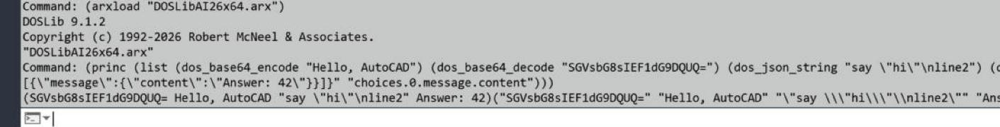
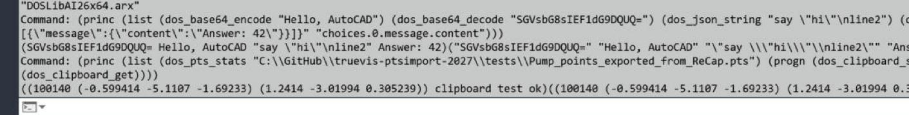
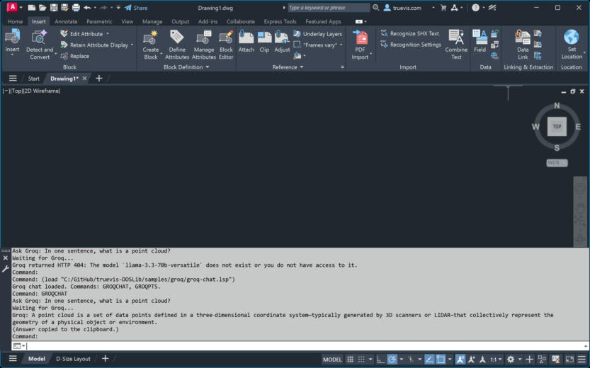
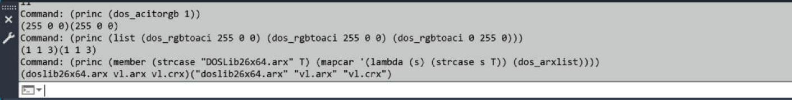
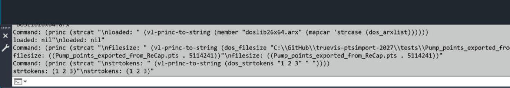
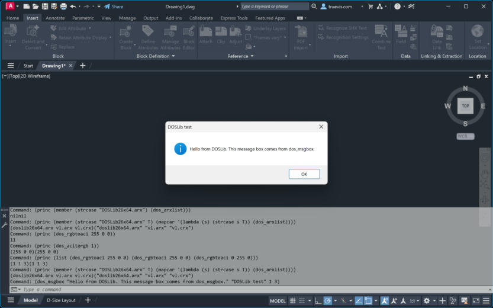
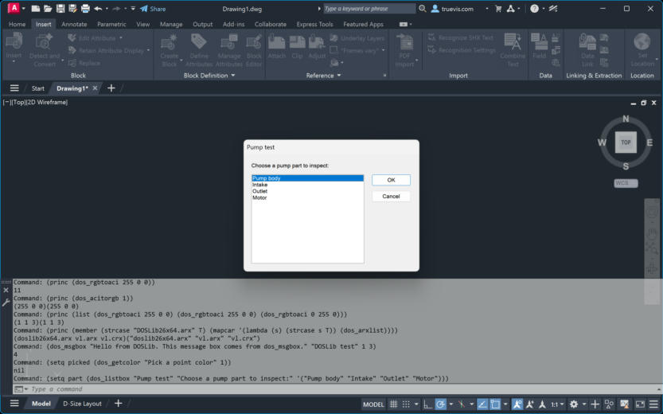
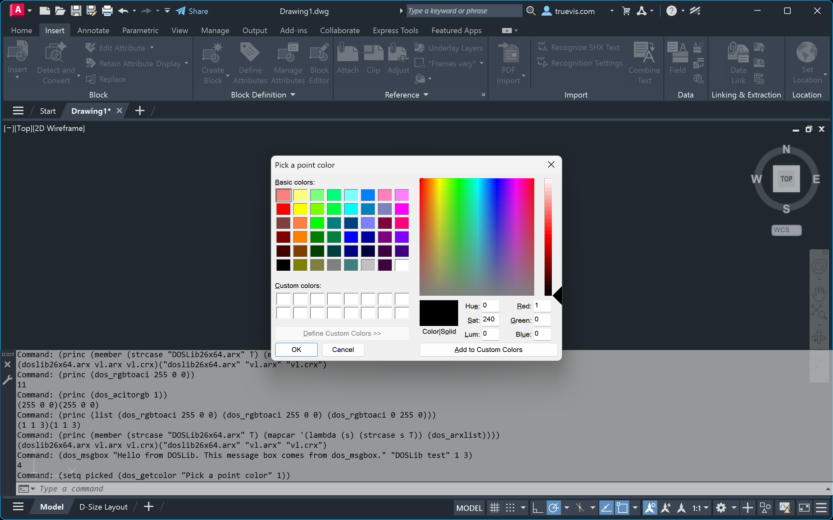
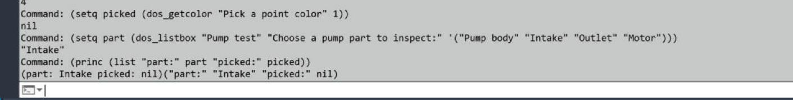

# DOSLib for AutoCAD 2026 and 2027

A build of **DOSLib**, a library of LISP-callable functions for AutoCAD that fill gaps in AutoCAD's built-in AutoLISP, such as file dialogs, file and folder utilities, and color conversion.

The original DOSLib by Dale Fugier is no longer maintained, and no binaries are published for recent AutoCAD releases. This fork builds the ObjectARX module for **AutoCAD 2027** (ObjectARX SDK 26) and **AutoCAD 2026.1.2** or later (ObjectARX SDK 25.1) from source.

> This is an unofficial fork. DOSLib is a trademark of Robert McNeel & Associates, who do not endorse or support this fork.

## New: AI and web functions

This fork adds helpers for calling web APIs, such as LLMs, from AutoLISP:

| Function | What it does |
|---|---|
| `dos_http_request` | Sends an HTTP or HTTPS request (GET, POST, and others). Returns `(status body)`. |
| `dos_json_get` | Reads a value from JSON text by dotted path, such as `"choices.0.message.content"`. |
| `dos_json_string` | Returns a JSON string literal, with quotes and escapes, for building request bodies. |
| `dos_base64_encode` / `dos_base64_decode` | Base64 conversion, for payloads and images. |
| `dos_clipboard_get` / `dos_clipboard_set` | Read and write the Windows clipboard. |
| `dos_pts_stats` | Point count and bounds of a `.pts` point cloud, as `(count (min) (max))`. |

A sample AutoLISP app for Groq (`samples/groq/`) uses these to chat with a free LLM. It asks for your own Groq API key and does not store it. An OpenRouter example is in `samples/openrouter/`.

When the module loads, AutoCAD prints `Updated for 2026 and 2027 by Eric Boehlke, truevis.com`.

### Screenshots (AutoCAD 2027)

- **Base64 and JSON:** `dos_base64_encode`, `dos_base64_decode`, `dos_json_string`, and `dos_json_get` on test strings.

  
- **Point-cloud statistics and clipboard:** `dos_pts_stats` on the sample `.pts` file, and `dos_clipboard_set` and `dos_clipboard_get` round-trip.

  
- **HTTP and LLM calls:** `dos_http_request` with `dos_json_get` in the Groq sample. These are the GROQCHAT and GROQPTS screenshots in the [Groq sample README](samples/groq/README.md).

  

## Get DOSLib

You can **build from source** or **use a prebuilt module**. The repository ships the full C++ sources and Visual Studio project (`source\DOSLib.vcxproj`, `make\make_doslib.sln`). ObjectARX SDK paths are not included—you install those locally per [BUILDING.md](BUILDING.md). Build outputs under `bin\` and `source\x64\` are generated on your machine and are not committed.

### Build from source

1. Install Visual Studio 2026 Build Tools with the C++ workload, ATL, and MFC, plus the v145 toolset.
2. Download the ObjectARX SDK for your AutoCAD release from Autodesk Platform Services and unpack it to `\acad\arx\25` (2026) or `\acad\arx\26` (2027) at the drive root.
   > **Supported versions:** AutoCAD 2027 (ObjectARX SDK 26) and AutoCAD 2026.1.2 or later (ObjectARX SDK 25.1, from `objectarx-for-autocad-2026-1-2-win-64bit.exe`). Both need Visual Studio 2026 with the v145 toolset (VC tools 14.40 or later) and .NET 10. Older AutoCAD 2026 releases and the v143 toolset are not supported.
3. Build:
   ```bash
    msbuild source\DOSLib.vcxproj /p:Configuration=Release_ARX26 /p:Platform=x64
    msbuild source\DOSLib.vcxproj /p:Configuration=Release_ARX25 /p:Platform=x64
   ```
4. Copy `bin\Release\arx\DOSLib26x64.arx` (2027) or `DOSLib25x64.arx` (AutoCAD 2026.1.2) to an AutoCAD support folder.

See [BUILDING.md](BUILDING.md) for toolsets, SDK layout, and troubleshooting.

### Prebuilt binaries (optional)

To use DOSLib in AutoCAD 2027 without compiling, copy the checked-in module from the repo:

- `arx/2027/DOSLib26x64.arx` (SHA256 `3c98b20618c538365581dffb4532d9aa5d19dc3f019e485ef786be8d96a833f5`)

Example support folders: `%APPDATA%\Autodesk\AutoCAD 2027\R26.0\enu\Support` for `DOSLib26x64.arx`, and the matching 2026.1.2 support path for `DOSLib25x64.arx`. A verified `DOSLib25x64.arx` (2026.1.2) build will be added under `arx/2026/` when ready. After you build locally, you can copy your own `.arx` from `bin\Release\arx\` instead—same file name.

## Using DOSLib

Load the module with `ARXLOAD` or by putting the `.arx` on the support path and loading it from AutoLISP:

```lisp
(arxload "DOSLib26x64.arx")
```

Functions are named `dos_*`. Example from a working command:

```lisp
(setq fname (dos_getfiled "Select a file" "C:\\" "PTS files (*.pts)|*.pts||"))
```

The full function reference is in [docs/functions](docs/functions/README.md): all 316 `dos_*` functions, with syntax, parameters, return values, and examples.

## Tested in AutoCAD 2027

Checked in AutoCAD 2027 with `DOSLib26x64.arx` loaded:

- **Module loaded:** `dos_arxlist` lists `doslib26x64.arx`.

  
- **File size:** `dos_filesize` on the 5,114,241-byte sample `Pump_points_exported_from_ReCap.pts` returns `(("Pump_points_exported_from_ReCap.pts" . 5114241))`.
- **Tokenizing:** `dos_strtokens "1 2 3" " "` returns `(1 2 3)`.

  
- **Color conversion:** `dos_rgbtoaci` maps `(255 0 0)` to ACI 1 (red) and `(0 255 0)` to ACI 3 (green). `dos_acitorgb 1` returns `(255 0 0)`.

### Dialogs and pop-ups

These DOSLib functions open standard Windows dialogs from AutoLISP, with results returned to your code:

- `dos_msgbox`**:** shows a message box with the Information icon and an OK button. Clicking OK returns `4`, as documented.

  
- `dos_listbox`**:** shows a list of pump parts. Choosing "Intake" and clicking OK returns `"Intake"`.

  
- `dos_getcolor`**:** opens the Windows color picker, starting at ACI 1. Clicking Cancel returns `nil`. Choosing a color with OK was not tested here.

  

The command-line results for these calls:



## Example: PTS point-cloud import

The PTS import command for AutoCAD uses DOSLib for its file dialog, file size, and RGB-to-ACI color mapping. It imports ReCap `.pts` files as colored POINT entities.

- Product page: [truevis.com/pts-import](https://truevis.com/pts-import/)
- Autodesk App Store: [marketplace.autodesk.com](https://marketplace.autodesk.com/apps/466a254c-dcf0-44d8-96c0-300b4323f60b)

## What changed from upstream

- **AutoCAD 2027 target:** `Release_ARX26` builds `DOSLib26x64.arx`.
- **AutoCAD 2026.1.2 target:** `Release_ARX25` builds `DOSLib25x64.arx`.
- **Fix:** the `Release_ARX26` configuration defined `ARX25` instead of `ARX26`. That made `_ARX_VER` evaluate to 25 in the 2027 build. It is now `ARX26`.
- **Docs:** `BUILDING.md` covers the build and SDK layout for both releases.

The upstream history is preserved.

## License

MIT License. See [LICENSE](LICENSE). The original copyright (Robert McNeel & Associates, 1992–2026) is retained, and changes in this fork are offered under the same license.

## Credits

- Original DOSLib: Dale Fugier, Robert McNeel & Associates.
- AutoCAD 2026/2027 build and maintenance: truevis.
