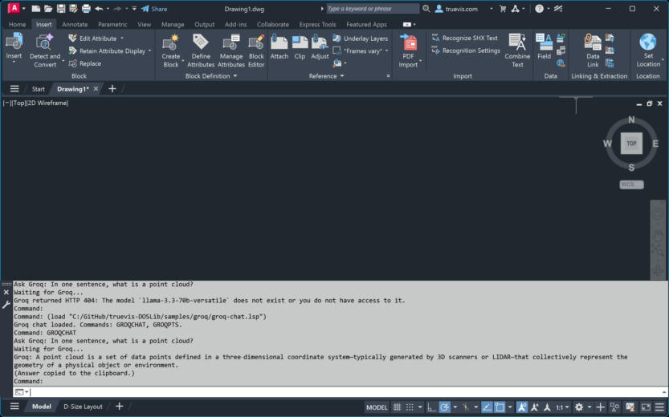
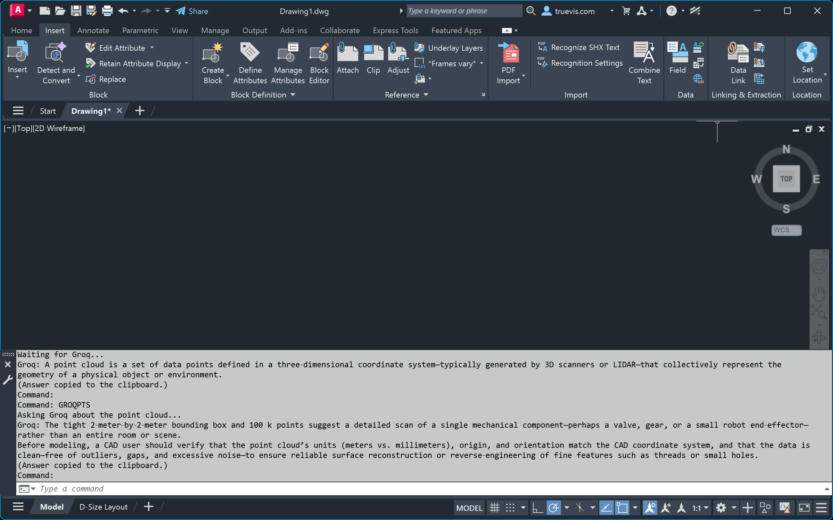

# Groq sample for AutoCAD

[`groq-chat.lsp`](groq-chat.lsp) chats with an LLM hosted by [Groq](https://groq.com) from AutoCAD, using the DOSLib AI functions. [`groq-text.lsp`](groq-text.lsp) spell-checks or translates drawing text.

- **Commands:** `GROQCHAT` asks a question. `GROQPTS` picks a `.pts` point cloud, sends its statistics from `dos_pts_stats`, and asks the model to describe it. `GROQTEXT` (in `groq-text.lsp`) selects TEXT and MTEXT, then spell-checks them or translates them into a language you name. It uses `openai/gpt-oss-120b`. You can write the result back onto the entities. MTEXT formatting codes are stripped, so font and color overrides in the original are not kept.
- **API key:** create one at [console.groq.com/keys](https://console.groq.com/keys). The sample asks for it once per session in a masked dialog (`dos_getpassword`). It is never written to a file.
- **Endpoint:** `https://api.groq.com/openai/v1/chat/completions`, the same request format as OpenRouter. See the [OpenRouter guide](../openrouter/README.md) for the call in detail.
- **Model:** `groq-chat.lsp` uses `*groq-model*`, default `openai/gpt-oss-20b`. `groq-text.lsp` uses `*groqtxt-model*`, default `openai/gpt-oss-120b`. Model availability depends on your key. List the models your key can use with `GET https://api.groq.com/openai/v1/models`.

## Tested in AutoCAD 2027

- **`GROQCHAT`:** the question "In one sentence, what is a point cloud?" returned a one-sentence answer. The answer was printed on the command line and copied to the clipboard.

  

- **`GROQPTS`:** with the sample `.pts` file (100,140 points), the model described the scene from its bounding box and point count.

  

- **Error handling:** when the model name `llama-3.3-70b-versatile` was not available to the test key, Groq returned HTTP 404. The sample printed Groq's `error.message` text. That confirmed the error path reads the JSON error correctly.
