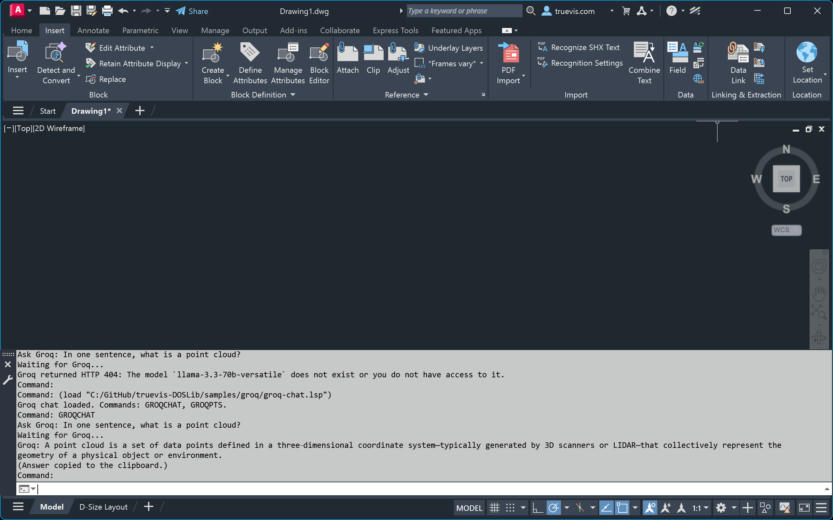
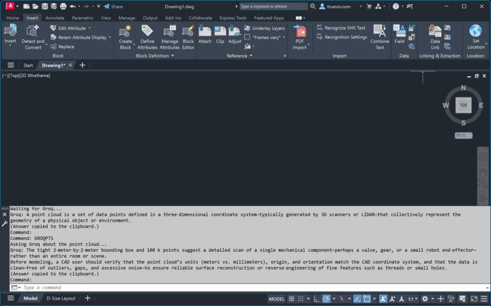
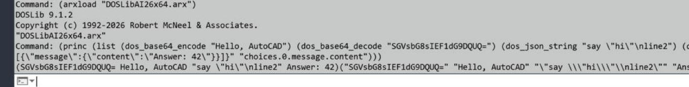
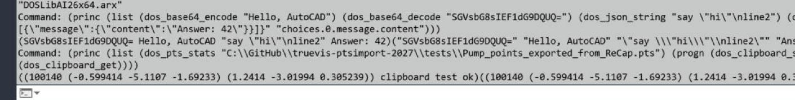

# What's new: call an LLM from AutoLISP

This fork of DOSLib adds the pieces AutoLISP was missing for web APIs: HTTPS, JSON, Base64, and the clipboard. Together they let a drawing talk to a language model.

Load the module, ask a question, and the answer comes back on the command line.

In the shot above, `GROQCHAT` asked Groq "In one sentence, what is a point cloud?" The reply was printed and copied to the clipboard. An earlier try with a model the key could not use printed Groq's HTTP 404 message instead of failing silently.

## The new functions

| Function | What it does |
|---|---|
| `dos_http_request` | Sends an HTTP or HTTPS request (GET, POST, and others). Returns `(status body)`. |
| `dos_json_get` | Reads a value from JSON text by dotted path, such as `"choices.0.message.content"`. |
| `dos_json_string` | Returns a JSON string literal, with quotes and escapes, for building request bodies. |
| `dos_base64_encode` / `dos_base64_decode` | Base64 conversion, for payloads and images. |
| `dos_clipboard_get` / `dos_clipboard_set` | Read and write the Windows clipboard. |
| `dos_pts_stats` | Point count and bounds of a `.pts` point cloud, as `(count (min) (max))`. |

When the module loads, AutoCAD prints `Updated for 2026 and 2027 by Eric Boehlke, truevis.com`.

## Spell-check or translate drawing text

`GROQTEXT` in [`samples/groq/groq-text.lsp`](samples/groq/groq-text.lsp) lets you select TEXT and MTEXT, then send that wording to Groq's `openai/gpt-oss-120b` model.

- **Spell-check** corrects spelling and grammar and keeps the original language.
- **Translate** asks for a target language and returns only the translation.

Each entity is one request. You can write the result back onto the entity or leave the drawing alone. Either way, the replies are copied to the clipboard. MTEXT formatting codes are removed before the call, so font, color, and stacked-fraction overrides in the original are not kept when the text is replaced. The command reuses the Groq API key from `GROQCHAT` if you already entered one this session.

## Ask about a point cloud

`GROQPTS` opens a file dialog, reads the cloud with `dos_pts_stats`, and asks the model to describe it. The sample file has 100,140 points. The model treated the tight bounding box as a scan of one mechanical part and suggested checking units and origin before modeling.

## JSON, Base64, and the clipboard

The same session that loaded `DOSLibAI26x64.arx` (DOSLib 9.1.2) exercised the helpers on the command line.

Base64 round-trip of `"Hello, AutoCAD"`, a JSON string with an embedded newline, and `dos_json_get` pulling `Answer: 42` out of a chat-style payload:

`dos_pts_stats` on `Pump_points_exported_from_ReCap.pts` returned the count and the min/max corners. The clipboard was set to `clipboard test ok` and read back in the same expression:

## Try it

Two samples ship with the repo. Each asks for your API key once per session in a masked dialog and does not write the key to a file.

- **Groq** — [`samples/groq/groq-chat.lsp`](samples/groq/groq-chat.lsp). Commands: `GROQCHAT`, `GROQPTS`. [`samples/groq/groq-text.lsp`](samples/groq/groq-text.lsp) adds `GROQTEXT` for spell-check and translation with `openai/gpt-oss-120b`. See the [Groq sample README](samples/groq/README.md).
- **OpenRouter** — [`samples/openrouter/openrouter-chat.lsp`](samples/openrouter/openrouter-chat.lsp). Command: `ORCHAT`. The [OpenRouter guide](samples/openrouter/README.md) shows the request built with `dos_json_string`, sent with `dos_http_request`, and read with `dos_json_get`.

Any provider that speaks the OpenAI chat format works the same way: change the URL, the key, and the model id.

The rest of the library — file dialogs, string and path helpers, color conversion, and the full list of 316 `dos_*` functions — is in the [function reference](docs/functions/README.md) and the [project README](README.md).
